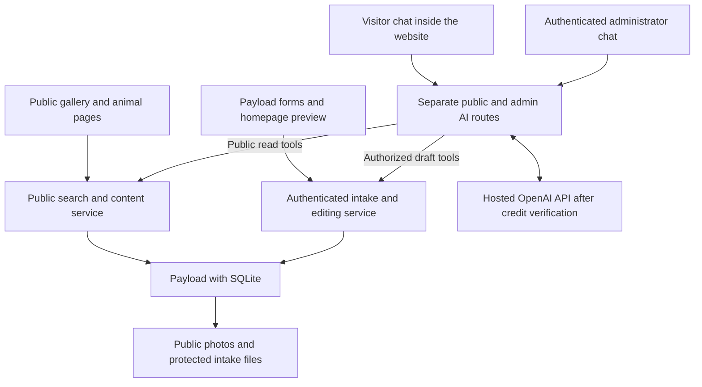

# Cat and Dog Rescue Implementation Plan

## Current scope — November 17, 2026

This CMS manages the website; the rescue uses a separate system for animal operations. Intake and private intake-file tools are retired and inaccessible, with existing storage retained. Future administrator automation should create and update Animals directly, using its drafts, photos, and version history. Rescue intake ID and Internal notes remain; unused age-reference and energy-level controls are removed from the editor. Weight is optional and displayed on the public animal profile when provided.

This scope supersedes the intake-processing roadmap below, which is retained as historical planning context.

Prepared November 5, 2026. Updated November 7, 2026: the first local implementation is working.

## Current implementation status

The local Payload + Next.js application now uses SQLite and local uploads. The approved desktop and mobile homepage designs, URL-based gallery filters, animal profiles, knowledge pages, manual animal/intake forms, weekly homepage editing, authenticated preview, and staff permissions are implemented. Fictional seed content supports local review. Setup, seed, backup, restore, and development commands are documented in the project README.

Production compilation and TypeScript checks pass. Seven backend integration tests cover publication privacy, compatibility filtering, private intake access, staff roles, public field projection, homepage drafts, and the manual intake-to-adoption lifecycle. Browser checks cover desktop/mobile rendering, gallery filtering and empty results, mobile navigation, animal profiles, and first-administrator setup. A backup/restore drill passed SQLite integrity verification.

AI remains disabled in both the interface and server endpoint, with no provider calls or configured API key. API credit eligibility and balance have not been verified. Visitor AI, administrator AI/photo extraction, the custom intake review screen and revision-bound publication confirmation remain future work. A real content-manager usability session and production hosting/migrations are also pending. The sections below describe the full target scope, not a claim that every planned milestone is complete.

Build a local Payload CMS and Next.js application for a rescue organization. The first demo includes a searchable animal gallery, visitor chat inside the website, and an authenticated administrator AI assistant inside the application. One nontechnical manager will maintain animal records and choose homepage highlights each week. Enable AI only after verifying available API credits from the user's Pro subscription; ordinary CMS forms and filters remain fully usable without AI.

## Decisions and scope

- Use Payload CMS, Next.js, React, and TypeScript in one project.
- Keep the application, database, animal photographs, and private intake documents on the development computer initially.
- Start with SQLite and local file storage. Do not require Docker or paid hosting for the demo.
- Run AI conversations inside the website through a server-side API integration, using activated API credits from the existing Pro subscription if available. Verify the credit balance before enabling any model requests. Keep ChatGPT subscription access distinct from API authentication and billing.
- Preserve the original visitor goal: gallery filters plus conversational animal search and answers about adoption, volunteering, and pet care.
- Preserve the original administrator goal: animal photo plus information-card photo, AI-assisted draft, human review, then publication.
- The weekly editing task is selecting featured animals for the homepage and editing a short introduction. A weekly blog or general-purpose page builder is outside the initial scope.
- The manager must be able to complete all routine content work without AI or code.
- Treat Payload as the initial source of truth. No existing rescue-management integration has been identified; confirm before importing live operational records.
- Aim for no additional spending during local development. Do not activate paid services or automatic recharge as part of the scaffold.
- Use GPT-6.1 Sol subagents at high reasoning for implementation. Use GPT-6 Luna for simple QA, escalating to GPT-6.1 Sol at high reasoning when complex checks require it. The primary agent coordinates and integrates their work.

Working assumptions: one rescue, one content manager, English content, and a small initial catalog. These simplify the first implementation without preventing additional staff later. Use fictional fixtures until the rescue provides approved animal information and policies.

## Architecture

Keep application rules in shared TypeScript services. The public gallery, CMS custom views, website AI routes, and future messaging integrations call the same services. AI proposes structured actions; these services authenticate, validate, search, save drafts, and publish. Public and administrative AI endpoints have separate authorization, tool sets, and conversation state.

The initial stack is Payload, its SQLite adapter and Lexical rich-text editor, Next.js, TypeScript, and straightforward responsive CSS. Use Payload's existing administration components wherever possible. Add custom views for photo intake, administrator chat, and the simplified homepage workflow. Defer a separate search engine, vector database, job platform, and general agent orchestration framework until a demonstrated requirement justifies them.

### Local environment

The workspace was empty when this plan was created and was not a Git repository. Installed Node is `v24.19.0`; npm is available and a pnpm launcher is present. Docker was not found on PATH and is not required by this design.

Before scaffolding, verify a current stable Payload release and install a supported Node version. Payload's checked installation documentation currently requires `^22.23.4 || >=24.22.1`, so the existing Node version is below that requirement. Pin the chosen Node version, package manager, Payload packages, compatible Next.js version, and lockfile. Do not base the demo on a prerelease. [Payload installation](https://payloadcms.com/docs/getting-started/installation)

Provide documented commands for setup, development, build, seed, backup, and restore. Keep SQLite, uploaded files, credentials, and local backups outside Git. Bind to localhost by default. Phone testing will use an explicitly enabled local-network session; use local HTTPS if the selected browser camera API requires it, with ordinary file selection as a fallback.

## Content model

| Content | Purpose and initial fields |
| --- | --- |
| Animals | Stable ID, optional unique rescue intake ID, name, slug, species, gender, reported breed, age or estimated birth date, size, optional weight, energy level, compatibility assessments, public care needs, description, photos, and adoption status. |
| Homepage | Short introduction, ordered references to featured animals, optional heading, draft and published versions. |
| Knowledge articles | Title, category, rich-text body, published state, source or policy reference, reviewer, and review date. Categories cover adoption, volunteering, and general care. |
| Public media | Approved animal photos, responsive image variants, captions, alt text, and associations with animal records. |
| Intake submissions | Private card images and intake photos, submitted facts, source references, proposed fields, unresolved questions, associated animal or draft, and processing state. |
| Staff | Login and role. Begin with a content manager and a technical administrator; the developer account is separate from the manager account. |
| Change history | Actor, action, affected record, before/after revision, confirmation, and time. Use Payload versions for content history and a small activity collection for intake and agent actions. |

Keep publication state separate from adoption state. A record can be draft or published, while the animal can be available, on hold, or adopted. Archive obsolete records without losing their history.

Compatibility fields must support yes, no, unknown, and conditional, with explanatory notes. An unassessed animal must never match a positive compatibility filter. Store age estimates with their reference date so displayed age can advance; do not repeatedly rewrite a static age string.

Homepage features reference animal records rather than copying their names, photos, and availability. The available-animal highlight section excludes animals that become unavailable; it must not silently replace them with unapproved selections. Existing animal pages can show an adopted status.

## Nontechnical editing experience

Provide a small navigation focused on Animals, Homepage highlights, Adoption and volunteering information, and Care guides. Hide technical configuration from the content manager.

The weekly manual workflow is:

1. Open Homepage highlights.
2. Edit the introduction with a limited rich-text toolbar.
3. Search for and select available animals, then arrange their order.
4. Preview the actual homepage on desktop and mobile widths.
5. Publish, or leave a draft for later.

Implement the frontend integration required by Payload Live Preview. Rich text supplies familiar formatting; the homepage layout stays in a reusable template. A full drag-and-drop site builder is unnecessary for this task. [Rich-text editor](https://payloadcms.com/docs/rich-text/overview), [Live Preview](https://payloadcms.com/docs/live-preview/overview)

Both manual and AI-assisted changes go through the same draft, validation, preview, and publication workflow. A failed AI connection must not prevent editing or publishing through the CMS.

## Visitor experience

Build a responsive homepage, an adoption gallery, individual animal profiles, and readable knowledge pages. Start with filters for species, age group, size, gender, and compatibility, plus text search. Default to available animals. Keep filter state in the URL so searches can be shared and browser navigation behaves predictably.

Use paginated results, optimized image sizes, accessible labels, keyboard navigation, and useful empty/error states. Staff can update content without rebuilding the application. Publication and adoption-status changes invalidate affected cached pages and search results.

The conversational search design uses the same search function as the gallery. The assistant converts a request into validated filters and preferences, explains the interpreted criteria, and returns links to actual animal records. Do not quietly relax a visitor's essential constraints when no matches exist.

Adoption, volunteering, and care answers retrieve published, approved knowledge articles and identify their sources. Ask a clarifying question when needed, and refer unanswered policy questions to the rescue. Provide general care information; do not invent medical diagnoses or treatment instructions. No open-web research is needed in the first visitor assistant.

Keep the public assistant's tools read-only and limited to public fields. Administrative access must never be inherited by a visitor conversation.

## AI delivery and subscription boundary

The user selected AI conversations inside the website for the first local demo. Both visitor chat and the authenticated administrator assistant use the server-side API integration. The initial demo does not require an MCP connection or conversations in a separate ChatGPT/Codex interface.

### Verify API credits before enabling AI

Eligible Pro plans currently have a claimable API-credit benefit, but eligibility, activation, expiry, and available balance have not been checked for this account. Confirm those through the official billing interface for the API organization receiving the credits. If no supported read tool is available, have the owner check that interface; do not infer credits from a Pro subscription or assume a programmatic balance endpoint exists. [Subscription API credits](https://developers.openai.com/api/docs/guides/chatgpt-api-credits)

Keep AI disabled by default. Before enabling it, confirm an active credit balance and expiration date, configure a project API key securely on the server, and agree on a small demo spending allowance within the remaining credit. Verify how the receiving API organization behaves when included credits run out; do not enable automatic recharge or silently fall back to purchased credits or paid billing. If an included-credits-only boundary cannot be established, leave AI disabled unless the user separately authorizes a paid allowance. Do not assume a provider budget setting is a hard spending limit.

A provider balance can be consumed by other applications, so record the verification time and recheck before demo sessions. Enforce one shared, concurrency-safe application allowance across both assistants: reserve a conservative maximum cost before each request, then reconcile actual usage. Stop new requests when the allowance is exhausted, verification is stale, credits expire, or funding is uncertain. Application limits reduce spending but do not prove that a shared provider balance is unchanged or replace verification of the provider billing boundary.

If the benefit is absent, expired, or exhausted, keep AI disabled and continue building the manual CMS and gallery. Leave the AI acceptance criteria pending rather than substituting another conversation interface or presenting simulated responses as a completed feature. A future paid allowance requires a separate user decision.

### Website chat and photo processing

Use a server-side model adapter with validated tool inputs, structured extraction output, bounded tool calls, per-request token limits, rate limits, usage accounting, and an application spending allowance. Select a current model with image understanding and suitable structured-output/tool support when implementing, then pin its configuration. Use a small representative image set to compare quality and cost before expanding usage.

The administrator assistant can read authorized intakes and prepare animal or homepage drafts, including proposed changes to already-published content. Its tools cannot publish. Publication is a separate authenticated human UI action bound to the exact reviewed revision and approved photos. The visitor assistant receives only published animal records and approved knowledge articles. Handle interruptions, timeouts, and credit exhaustion with clear errors and working manual fallbacks. Keep account details and usage controls in administrative settings rather than the visitor interface.

The website and its stored data run locally, while selected image inputs and conversational context are sent to the hosted AI provider. Keep API keys server-side and out of source control. Use ordinary project API authentication; do not read ChatGPT session tokens or expose a signed-in coding agent as the website backend.

Keep prompts, tool schemas, and validation independent of provider transport. A later downgrade, API-provider change, or optional MCP/messaging adapter must not require changing animal data or the homepage editor. The user's implementation and QA subagent preferences are separate from the model and spending level selected for the website's runtime AI.

## Photo intake and approval

1. The manager creates an intake from a phone-friendly screen and uploads the animal photo and information-card photo as distinct inputs.
2. The application assigns an intake ID. With AI enabled after credit verification, the server reads the authorized intake images and sends them to the model through the API adapter.
3. The model proposes structured animal fields and a description grounded in the card and supplied notes. Preserve source evidence and flag unreadable, missing, or conflicting information. Never infer medical history, compatibility, temperament, or breed certainty from appearance.
4. The application validates the proposal and saves an unpublished draft. Check the rescue intake ID for duplicates and offer an explicit update flow when a matching record exists.
5. The manager sees the images, proposed fields, unresolved questions, and listing preview together. They can correct fields directly or ask the agent for changes.
6. The manager confirms the exact reviewed revision in the authenticated application. Revalidate and publish atomically. If the draft changed after review, require another review.
7. Refresh the gallery and show the resulting animal page. Record the responsible person and action history.

The same intake screen must work from start to finish with AI disabled or extraction failed: upload both images, enter all fields from scratch, save a draft, review, and publish through the authenticated human action. Manual entry must not depend on an existing AI proposal. Keep extraction acceptance pending when unfunded while validating the complete manual workflow locally.

The image path is browser upload into protected local storage, followed by server-side retrieval using an intake ID. Send the image bytes through the provider's supported input mechanism; do not assume the remote provider can fetch a localhost URL. Direct uploads into a separate ChatGPT conversation are outside the initial workflow.

Keep card images and internal intake notes behind authorization and out of public media URLs. Send only necessary extraction inputs to the model; allow cropping or redacting unrelated personal details on cards before submission and exclude unrelated internal notes from prompts. Public photos are explicitly selected for publication, resized, and stripped of unnecessary metadata. Add upload type/size limits and retain only the private source material needed for review under an agreed retention policy.

## Permissions and reliability

- Visitors can read published public content and currently available search results.
- The content manager can maintain drafts, review intake, publish permitted content, and change adoption status.
- Agent operations are bound to an authenticated actor and a narrow set of application actions. Draft preparation does not grant autonomous publishing or arbitrary database access.
- Enforce restrictions in application services and Payload access control, not solely in prompts or hidden interface controls. Payload Local API skips access control by default, so actor-bound calls must explicitly use `overrideAccess: false` and supply the appropriate user context. [Payload Local API](https://payloadcms.com/docs/local-api/overview)
- Publish animal and homepage changes only through an explicit authenticated human UI action. The server validates the reviewed record, revision, and approved photos; the model has no publish tool and cannot grant itself approval by proposing a confirmation flag. Apply this to changes to already-published records as well as new listings.
- Give submissions and write operations idempotency keys. Retried uploads, agent calls, or future messaging webhooks must not create duplicate animals or repeat publication.
- Treat instructions embedded in photos, descriptions, and retrieved articles as untrusted content. They cannot change tool permissions or authorize publication.
- Back up the database and both public/private media together. Provide a restore procedure and run it against a separate local location before handoff.

## Implementation milestones

| Milestone | Deliverables | Completion criteria |
| --- | --- | --- |
| 1. Local foundation | Supported Node, initialized repository, pinned Payload/Next.js scaffold, SQLite, local storage, environment example, and setup instructions. | A fresh setup starts locally, production build succeeds, and data survives restart. No paid infrastructure is required. |
| 2. Content and manual administration | Collections, staff access rules, drafts, media separation, knowledge fixtures, and ordinary animal editing. | Manager can create, edit, publish, and mark an animal adopted without AI. Anonymous requests cannot retrieve drafts or intake files. |
| 3. Gallery and weekly highlights | Responsive public pages, shared filtering, homepage animal picker/order, rich-text introduction, and working preview. | The actual manager completes a weekly update without developer assistance. Search and highlights reflect publication and adoption changes. |
| 4. Credit verification and in-website admin AI | Verified API-credit eligibility/balance/expiry and billing boundary, secure project key setup, disabled-by-default server adapter, shared usage controls, draft-only tools, and authenticated administrator chat. | With verified funding and AI enabled, the manager can prepare a homepage draft inside the website. With AI disabled, no model requests occur. Only a separate authenticated human UI action can publish the reviewed revision. |
| 5. Photo intake | Mobile upload/review screen, extraction into the defined schema, manual entry and corrections, duplicate handling, and activity history. | A photo pair becomes a reviewed listing; unclear text remains unresolved; retries do not create duplicates. With AI disabled, the manager can upload both images, enter fields from scratch, review, and publish. Live extraction validation remains pending if unfunded. |
| 6. Visitor conversation | Public website chat, read-only tools, approved knowledge retrieval, result cards, follow-up questions, and shared spending controls. | With verified funding, a visitor can search and ask questions inside the website. The assistant finds only real eligible animals, cites approved content, and cannot access private data or write records. Without funded API access, live AI validation remains explicitly pending. |
| 7. Local handoff | Seed/demo data, operator guide, engineer setup guide, backup/restore instructions, account inventory template, and maintenance checklist. | Another person can start the demo, perform the weekly update, add an animal manually, and restore a backup using the documentation. |

Build the manual workflow before AI assistance. Check credit eligibility and the available balance early; run a small text/image integration check only after AI is enabled under the agreed allowance. Milestones are completion gates, not fixed calendar estimates.

## Implementation and QA delegation

Use subagents configured as `gpt-6.1-sol` with reasoning effort `high` for implementation. For simple QA, use `gpt-6-luna`: examples include checking documentation consistency, running established checks, and verifying straightforward UI flows. Reserve `gpt-6.1-sol` at high reasoning for QA that needs deeper analysis, such as access-control boundaries, revision-bound publication, concurrent budget enforcement, complex agent behavior, or diagnosing ambiguous failures. Do not automatically repeat successful simple checks with the more expensive model. Give each subagent the relevant plan sections, acceptance criteria, file ownership, and current decisions explicitly when starting it.

The primary agent coordinates dependencies, assigns non-overlapping implementation work, integrates changes, and keeps this plan current. Parallelize independent tasks only when their interfaces and file boundaries are clear. A separate QA subagent reviews integrated work against the milestone criteria and reports concrete failures for implementation subagents to resolve. Keep commands and changes within the authorized local development scope.

Use subagents selectively for bounded work to conserve the user's subscription allowance. Do not promise additional free capacity or assume that delegated usage is unmetered. Human usability testing by the actual manager remains part of acceptance and is not replaced by agent QA.

## Validation

Use focused integration tests for authentication and access boundaries, draft/publication transitions, revision-bound confirmation, duplicate prevention, current availability, and unknown compatibility. Check public responses against an explicit allowlist of public fields; test direct private-media URLs and draft/preview endpoints for unauthorized access. Test the same search criteria through both filter and agent entry points.

Use a small end-to-end suite for the manager's weekly update and the photo-review-publish workflow. Include tests that disable AI, assert no outbound model requests, and complete the full photo-pair intake through manual entry, review, and publication, plus weekly editing and gallery search. Cover credit exhaustion, stale funding verification, concurrent requests against the shared budget, and separation of public and administrator conversations. Verify that assistant tools cannot publish animal or homepage changes, including updates to already-published records. Check mobile file selection, keyboard access, loading states, and real homepage preview.

Use a fixed set of representative animal-card images and expected extracted facts to evaluate OCR and model behavior. Include a blurry card, missing facts, contradictory notes, and text that attempts to instruct the assistant. Allow legitimate extraction uncertainty; do not test only ideal images.

Manually test with the actual manager before treating the editor as ready. The key usability task is: change the introduction, select/reorder featured animals, preview, and publish without touching code.

## Later hosting and integrations

Choose hosting only after measuring the demo's requirements and the rescue's budget. Preserve database and storage adapters, stable IDs, environment-based configuration, and repeatable deployment so hosting remains a separate decision. Moving SQLite data to PostgreSQL is a migration task, not just changing a connection string. A production move also includes media transfer, private-file access, backups, authentication configuration, monitoring, and cost limits.

Text/MMS, WhatsApp, Slack, or email intake can later feed the same submission and approval services. They will require channel setup, verified sender permissions, message-to-intake correlation, and retry handling. Keep the channel account and phone number owned by the rescue. Personal-dot texting is not assumed to provide a shared multi-staff inbox.

Defer donation/payment processing, adoption applications, volunteer scheduling, public accounts, external rescue-system synchronization, a mobile app, advanced semantic search, and general page building.

## Inputs to collect when needed

Ask one multiple-choice question at a time. The initial AI interface is decided: inside the website, enabled only after checking the available Pro API-credit balance. Implementation uses GPT-6.1 Sol subagents at high reasoning; simple QA uses GPT-6 Luna, with Sol at high reasoning reserved for checks that need deeper analysis. Subsequent milestones will need the rescue's name and visual assets, approved sample animal cards, actual adoption/volunteering policies, preferred public contact method, confirmation of the system of record, and who can publish. Missing real content does not prevent developing with clearly fictional fixtures.
